<!-- ============ 1. BANNER ============ -->

  

 

<!-- ============ 2. PROFILE CARD ============ -->

  

  
  &nbsp;&nbsp;
  

 

  

<!-- ============ 4. FEATURED PROJECTS (3 side by side) ============ -->
### 🚀 Featured Projects

  

  

  

  

<!-- ============ 5. TECH STACK (one line) ============ -->
<h3 align="center">🛠️ Tech Stack</h3>

  

<!-- ============ 6. CONTRIBUTIONS ============ -->
<h3 align="center">📈 Contribution Activity</h3>

  

  

<!-- ============ 7. CONNECT ============ -->
<h3 align="center">🤝 Let's Connect</h3>

  
  
  
  

<h2 align="center">🐍 My GitHub Contribution Snake</h2>

  

