<!-- ============ 1. BANNER ============ -->

  

 

<!-- ============ 2. PROFILE CARD ============ -->

  

 

  

<!-- ============ 4. FEATURED PROJECTS ============ -->
<h3 align="center">🚀 Featured Projects</h3>

<table width="100%" border="1" bordercolor="#26364f" frame="void" rules="all" cellpadding="14" cellspacing="8" bgcolor="#070d1d">
  <tr>
    <td width="50%" height="300" valign="top" bgcolor="#0a1128">
      

      
<strong>Kalakriti+</strong> 
      AI-driven market-linkage platform for artisans.

      
<code>React</code> <code>FastAPI</code> <code>PostgreSQL</code>

    </td>
    <td width="50%" height="300" valign="top" bgcolor="#0a1128">
      

      
<strong>RaahPrahari</strong> 
      Hill-road safety and community reports.

      
<code>React</code> <code>FastAPI</code> <code>PostgreSQL</code>

    </td>
  </tr>
  <tr>
    <td width="50%" height="300" valign="top" bgcolor="#0a1128">
      

      
<strong>Sakshya</strong> 
      Silent reporting with SHA-256 evidence integrity.

      
<code>React</code> <code>Node.js</code> <code>PostgreSQL</code>

    </td>
    <td width="50%" height="300" valign="top" bgcolor="#0a1128">
      

      
<strong>FixAura</strong> 
      AI home-repair assistant with AR guidance.

      
<code>React</code> <code>OpenAI</code> <code>Tailwind</code>

    </td>
  </tr>
</table>

<!-- ============ 5. TECH STACK (one line) ============ -->
<h3 align="center">🛠️ Tech Stack</h3>

  

<!-- ============ 6. CONTRIBUTIONS ============ -->
<h3 align="center">📈 Contribution Activity</h3>

  

  

<!-- ============ 7. CONNECT ============ -->
<h3 align="center">🤝 Let's Connect</h3>

  
  
  
  

<h2 align="center">🐍 My GitHub Contribution Snake</h2>

  

